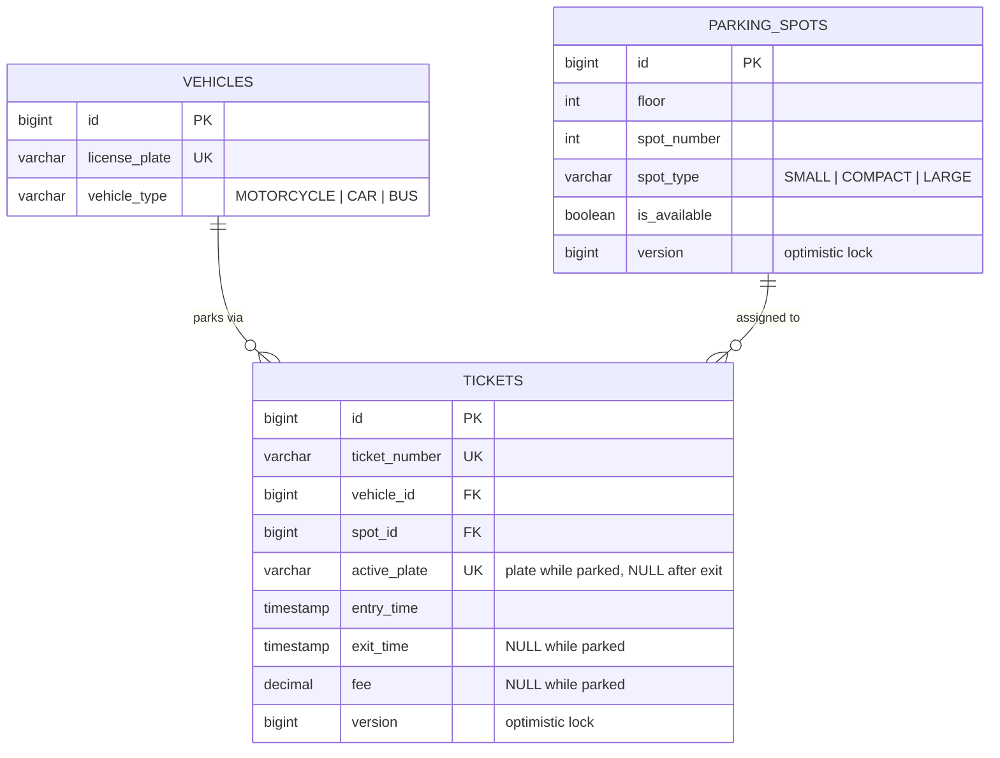

# Smart Parking Lot – Low-Level Design

## 1. Scope

Backend for a multi-floor urban parking lot that must: allocate a spot by vehicle size, record entry/exit, charge by duration and vehicle type, keep availability current, and stay correct under concurrent requests.


| Layer | Responsibility |
|---|---|
| Controller | HTTP mapping, request validation (`@Valid`), response wrapping |
| Service | Transaction boundary, retry, business rules (duplicate check-in, idempotent check-out), vehicle upsert |
| Strategy | Pluggable allocation and pricing algorithms (Open/Closed principle) |
| Repository | Persistence via Spring Data JPA, including the `SKIP LOCKED` spot query |
| Exception handler | Maps errors to HTTP: missing ticket (404), `IllegalStateException` (409), `IllegalArgumentException` (400), lock and integrity failures (409), validation, malformed JSON and unknown enum values (400, the message lists the allowed values) |

## 2. Class diagram

See [`ClassDiagram.md`](ClassDiagram.md) for the full class diagram, layer dependencies, vehicle → spot compatibility and the retry/transaction layering.

## 3. Data model



Notes
- **Active session:** a ticket with `exit_time IS NULL` is an active parking session. For fast and race-safe lookup, `active_plate` holds the plate while the session is open and is set to `NULL` on exit.
- **Why `active_plate`:** a unique column allows many `NULL`s in every major SQL database, so it behaves like a partial unique index (`UNIQUE ... WHERE exit_time IS NULL`) without any dialect-specific syntax. Two simultaneous check-ins for the same plate cannot both insert an active ticket: the loser hits the unique constraint.
- **Vehicles:** one row per license plate (unique). It is created on a plate's first visit and reused afterwards. The vehicle type is updated if the plate arrives with a different type (see limitations in section 9).
- **Indexes:** `parking_spots(spot_type, is_available)` for allocation; `tickets(ticket_number)` unique; `tickets(active_plate)` unique; `vehicles(license_plate)` unique.
- `fee` is a `BigDecimal` (exact money arithmetic, scale 2).
- Entities are never returned to clients; the service maps them to `TicketResponseDto`.
- Schema is generated by Hibernate (`ddl-auto=update`). A production deployment should use migration scripts (Flyway/Liquibase) instead.

## 6. Spot allocation algorithm

1. Map the vehicle to an ordered list of acceptable spot types (smallest fit first):

   | Vehicle | Order |
      |---|---|
   | MOTORCYCLE | SMALL, COMPACT, LARGE |
   | CAR | COMPACT, LARGE |
   | BUS | LARGE |
2. For each type in order, query the first available spot sorted by `floor ASC, spotNumber ASC` (nearest to ground/entrance). The query takes a pessimistic write lock with **`SKIP LOCKED`**, so rows already locked by another in-flight check-in are skipped rather than waited on.
3. First hit wins; if none, throw `IllegalStateException("Parking lot is completely full ...")` → HTTP 409.

Why: best-fit keeps large spots free for buses; ordering gives deterministic, nearest-first assignment; `SKIP LOCKED` means concurrent requests are handed *different* spots instead of all contending for the same first row. Cost is one indexed query per candidate type (at most 3).

Trade-off: preference is by *type first, then floor*, so a motorcycle will take a SMALL spot on floor 3 before a COMPACT spot on floor 1.

## 7. Fee calculation

```
seconds = Duration(entry, exit).getSeconds()
hours   = max(1, ceil(seconds / 3600))
fee     = hours x baseRate x multiplier      # BigDecimal, scale 2, HALF_UP
```

Defaults (configurable in `application.properties`): base rate ₹20, multipliers MOTORCYCLE 0.5, CAR 1.0, BUS 2.5.

Examples: Car 1h15m → 2h → ₹40. Bus 5 min → 1h → ₹50. Motorcycle 60 min → ₹10. Car 60 min 1 s → 2h → ₹40.

Exit before entry throws `IllegalArgumentException`. The strategy sits behind `FeeCalculationStrategy`, so a tiered, daily-cap or peak-hour implementation can be swapped in without touching the service.

## 8. Concurrency handling

| Risk | Mitigation in code |
|---|---|
| Many simultaneous check-ins contend for the same "first" spot | `SELECT ... FOR UPDATE SKIP LOCKED` on the candidate spot: each transaction locks a different free row |
| Two vehicles get the same spot (safety net) | `@Version` on `ParkingSpot`; a stale `UPDATE ... WHERE version = ?` fails, the transaction rolls back and no ticket is created |
| Partial state (spot locked, no ticket) | Check-in and check-out each run in one `@Transactional` boundary |
| Lock or version conflict | `@Retryable` on `checkIn` and `checkOut` retries on `ObjectOptimisticLockingFailureException` and `CannotAcquireLockException` (5 attempts, randomised exponential backoff). The retry advice is ordered *outside* the transaction so commit-time failures are caught and the whole transaction is re-run |
| Retries exhausted | The exceptions are mapped to HTTP 409 with a "please try again" message |
| Same plate checked in twice sequentially | `existsByActivePlate` check before allocation |
| Same plate checked in twice simultaneously | Unique `active_plate` column: the second insert violates the constraint, the transaction rolls back and the client receives 409 |
| Two simultaneous check-outs of one ticket | `@Version` on `Ticket`: the loser fails, is retried, sees `exitTime` already set and returns the stored result. The fee is charged once |
| Client retries check-out | Idempotent: an already-closed ticket returns the stored result and never recharges |

## 9. Known limitations and trade-offs

- **`SKIP LOCKED` can report "full" early.** If every free spot of a type is momentarily locked by other in-flight check-ins, the query returns nothing and the request falls through to a larger type or returns 409, even though a spot could free up a moment later. The client may simply retry.
- **Vehicle type is stored once per plate.** If a plate later arrives with a different type, the stored type is updated. Older tickets of that vehicle then display the new type, although their fee was calculated with the old one. Storing a `vehicle_type` snapshot on the ticket would preserve history.
- **First-visit race.** Two simultaneous first-time check-ins of the same new plate both try to insert the vehicle; the loser hits the unique constraint and gets a 409 conflict rather than the "already parked" message.
- **In-memory database.** H2 in-memory data is lost on restart; the design is portable to PostgreSQL/MySQL. `SKIP LOCKED` requires a database that supports it (H2 2.2+, PostgreSQL 9.5+, MySQL 8+).
- **Fee model is simple.** There are no daily caps, grace period or peak pricing; the strategy interface exists to add them.

## 10. Real-time availability

Availability is the `is_available` column, updated atomically with the ticket in the same transaction, so reads always see the committed current state. `GET /api/v1/parking/availability` exposes it: the service calls `ParkingSpotRepository.countAvailableSpotsByFloorAndType()` and returns free-spot counts grouped by floor and spot type (floors and types with no free spots are reported as 0).

## 11. Configuration

| Property | Default | Meaning |
|---|---|---|
| `parking.rates.base-hourly` | 20.00 | Base rate per hour |
| `parking.rates.multiplier.motorcycle` | 0.5 | Motorcycle multiplier |
| `parking.rates.multiplier.car` | 1.0 | Car multiplier |
| `parking.rates.multiplier.bus` | 2.5 | Bus multiplier |